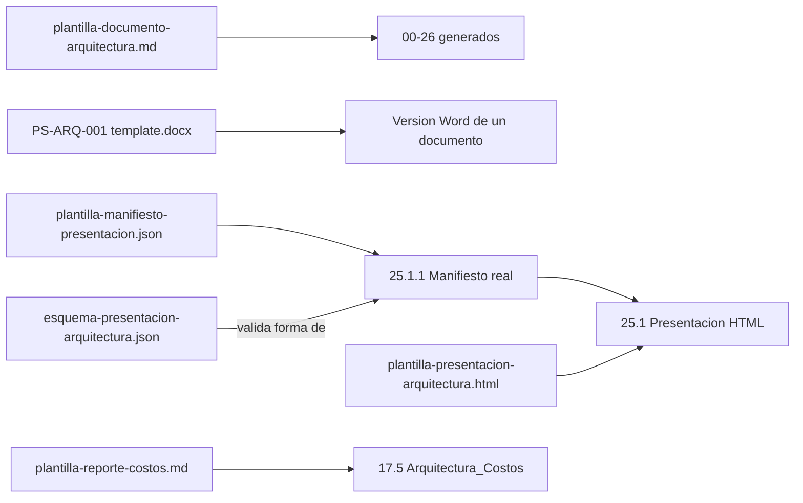

# Contratos y artefactos

`archi` no define JSON Schemas de contrato como `solution-baseline`; sus "contratos" son plantillas y assets reutilizables que estructuran la salida documental y la presentación de Comité. Todos viven en [assets/](../../skills/archi/assets/) o, en el caso de la plantilla Markdown, en [references/](../../skills/archi/references/).

## Relación entre artefactos

## Contratos disponibles

| Artefacto | Ubicación | Función |
|---|---|---|
| Plantilla de documento de arquitectura | [plantilla-documento-arquitectura.md](../../skills/archi/references/plantilla-documento-arquitectura.md) | Estructura `00`-`26`, propiedad documental, criterios de cierre y trazabilidad completa que sigue cada Markdown generado |
| Plantilla DOCX | [`PS-ARQ-001 template.docx`](<../../skills/archi/assets/PS-ARQ-001 template.docx>) | Plantilla documental corporativa para entregar un artefacto de arquitectura en formato Word |
| Manifiesto de presentación | [plantilla-manifiesto-presentacion.json](../../skills/archi/assets/plantilla-manifiesto-presentacion.json) | Base estructurada para construir el manifiesto real `25.1.1-Manifiesto-Presentacion_<Proyecto>.json` |
| Esquema de presentación | [esquema-presentacion-arquitectura.json](../../skills/archi/references/esquema-presentacion-arquitectura.json) | Contrato de forma que valida el manifiesto `25.1.1` antes de generar el HTML |
| Plantilla HTML de presentación | [plantilla-presentacion-arquitectura.html](../../skills/archi/assets/plantilla-presentacion-arquitectura.html) | Base autocontenida y adaptable por audiencia (Ejecutiva/Arquitectura/Completa) para `25.1` |
| Plantilla de reporte de costos | [plantilla-reporte-costos.md](../../skills/archi/references/plantilla-reporte-costos.md) | Correspondencia entre pricing, arquitectura y recomendación, usada como base de `17.5-Arquitectura_Costos_<Proyecto>.html` |

## Manifiesto y esquema de presentación

El manifiesto `25.1.1` es la única fuente que alimenta el HTML `25.1`; según `SKILL.md` y `release.md`, debe cumplir campos obligatorios: `schemaVersion`, `project`, `scenario`, `review`, `decisionRequest`, `executiveSummary`, `workPerformed`, `drivers`, `alternatives`, `selection`, `architecture`, `security`, `validation`, `risks`, `sources`, `conflicts`.

`scripts/generate_architecture_presentation.py` valida esta forma contra el esquema, calcula hashes SHA-256 de cada fuente enlazada, resuelve enlaces relativos dentro del project-root y evalúa el gate de aprobación antes de producir el HTML. `scripts/validate_architecture_presentation.py` revalida el HTML ya generado: estructura, fuentes, hashes, assets, operación offline y coherencia del gate.

Los faltantes se muestran como `Missing evidence` y las contradicciones se registran explícitamente en el manifiesto; una versión no apta muestra permanentemente `BORRADOR — NO APTO PARA APROBACIÓN`.

## Plantilla de documento de arquitectura

`plantilla-documento-arquitectura.md` fija la estructura `00`-`26` que sigue todo documento generado por `archi`: cada Markdown termina con una sección `## Criterios de cierre` expresada como checklist verificable, con estados permitidos `Cumple`, `Cumple con observaciones`, `No cumple` y `No aplica`. Un criterio aplicable pendiente deja el artefacto en `No cumple`; `Cumple con observaciones` exige todos los criterios cumplidos y solo admite mejoras no bloqueantes con responsable y fecha.

En Casos A/C, `01-Linea-Base_<Proyecto>.md` incorpora además el contrato DR-01 de [guia-preparacion-dominio.md](../../skills/archi/references/guia-preparacion-dominio.md): clasificación de complejidad, aplicabilidad y estado de Event Storming, evidencia, estado del gate, hotspots bloqueantes, handoff pendiente y justificación. `validate_architecture_coherence.py` rechaza una arquitectura A/C sin esa sección o con un gate que no habilite la continuación.

## Plantilla DOCX

`PS-ARQ-001 template.docx` es la plantilla documental corporativa usada para producir versiones Word de los artefactos de arquitectura cuando la audiencia lo requiere (por ejemplo, para RFP o distribución externa). No tiene script de validación asociado en `scripts/`.

## Plantilla de reporte de costos

`plantilla-reporte-costos.md` estructura la correspondencia entre el pricing calculado, la arquitectura de despliegue y la recomendación final; exige fecha, región, moneda, fuentes, dimensionamiento y totales verificables — es la base narrativa detrás de `17.4-Pricing_<Proyecto>.md` y `17.5-Arquitectura_Costos_<Proyecto>.html`.

## Catálogo de iconos (assets visuales, no contratos documentales)

Aunque no son "contratos" en el sentido de artefactos de decisión, `assets/iconos/` sí actúa como un contrato de representación visual: `catalogo_iconos_curado.json` (50 iconos Azure2/AWS4/GCP3), `aliases_iconos.json` (resolución estable de términos a `archiIconId`) y `catalogo_iconos.schema.json` (contrato de estructura y compatibilidad del catálogo). Se detalla en [08-inventario-de-implementacion.md](./08-inventario-de-implementacion.md) y se valida con `scripts/validate_drawio_catalog.py` (ver [05-cli-y-operacion.md](./05-cli-y-operacion.md)).

## Costos por ambiente — contrato vigente

[contrato-costos.md](../../skills/archi/references/contrato-costos.md) define `17.4.1-Costos_<Proyecto>.json`, fuente numérica de `17.4` y `17.5`. Cada partida declara proveedor/recurso, región, SKU, medidor, unidad/tarifa, evidencia/fecha, cantidades por escenario y asignaciones por ambiente. El inventario independiente de `17` se cruza contra esas partidas; costos mensuales y únicos se totalizan separados.

Los bloques delimitados de Markdown/HTML se generan desde el manifiesto y se verifican con el mismo cálculo. Las tarifas se clasifican como públicas, contractuales, observadas o aproximadas; la evidencia comercial y la completitud del despliegue requieren revisión adicional al chequeo aritmético. Dev/staging no se presupuestan como porcentaje global de producción.
