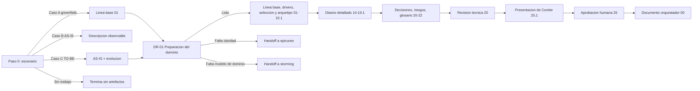

# Archi — documentación

Esta documentación explica la capacidad `archi` implementada en OCTO-HR: qué resuelve, cómo se opera, cuáles son sus contratos y plantillas, cómo se valida y qué evidencia real existe de su ejecución sobre este repositorio.

## Objetivo

`archi` es una skill con un agente top-level delgado que hace que Claude actúe como **arquitecto de software senior**: prioriza atributos de calidad según contexto, explicita riesgos y trade-offs, evita sobrediseñar y escribe siempre en español con tono profesional.

Cubre de punta a punta el diseño de una arquitectura nueva desde especificaciones (greenfield), la documentación o auditoría de la arquitectura de un repositorio existente (AS-IS), la evolución AS-IS → TO-BE con análisis de brechas y roadmap, y la preparación de una presentación ejecutiva o para Comité de Arquitectura — además de arquetipos de solución, vistas C4, microfrontends, gobierno/diseño de APIs, modelos de datos, despliegue/multi-nube/costos, ADR, atributos de calidad, patrones, Clean Code y modelo de amenazas.

No es una skill para dudas puntuales sobre una función o archivo aislado: trabaja siempre a nivel de sistema. No genera DevOps, IaC, contenedores operacionales, despliegues ni baselines de repositorio ejecutables; esas responsabilidades pertenecen a Vulcano y `solution-baseline` respectivamente.

## Estado actual

| Capacidad | Estado |
|---|---|
| Skill como fuente de verdad (`SKILL.md`) | Implementada |
| Agente de entrada directa [`archi.agent.md`](../../agents/archi.agent.md) | Implementado |
| 6 scripts de generación/validación en `scripts/` | Implementados |
| 33 referencias temáticas en `references/`, agrupadas en 11 categorías | Implementadas |
| Gate DR-01 de preparación del dominio para Casos A/C | Implementado y validado por `validate_architecture_coherence.py` |
| Assets reutilizables (plantilla DOCX, manifiesto/esquema JSON, HTML de presentación, catálogo curado de iconos) | Implementados |
| Evidencia real y fechada de ejecución sobre este repositorio | Histórica: 2 de los 5 scripts originales; el sexto CLI de pricing añade 15 pruebas sintéticas, sin certificar tarifas reales |
| Evidencia de ejecución de `validate_architecture_presentation.py` y `extract_postman_inventory.py` | No registrada en este repositorio |
| Pricing histórico | Requiere migración a `17.4.1` y revisión de evidencia; el validador no certifica tarifas |
| Agentes dedicados y paralelismo | Un agente directo; sin subagentes ni paralelismo interno |

## Por qué Archi tiene un solo agente

La cantidad de artefactos no determina la cantidad de agentes. En Archi, alternativas, contenedores,
APIs, datos, despliegue, seguridad, decisiones y riesgos forman un único modelo con IDs y checkpoints
compartidos. Dividir su escritura sin un contrato de ownership produciría decisiones divergentes y
validaciones sobre snapshots incompatibles.

La independencia necesaria ya se cubre mediante selección y aprobación humanas, checkpoints de
coherencia y validadores deterministas. A diferencia de Solution Baseline, Archi no tiene hoy unidades
de repositorio con leases ni writers paralelos; y, a diferencia de Vulcano, no cruza tres niveles de
permiso — definición, generación local y operación remota. Por eso el agente `archi` conserva una sola
autoridad arquitectónica y reporta handoffs externos sin ejecutarlos.

Solo se justificaría una célula futura si se definen un manifiesto de ejecución, ownership exclusivo
por artefacto, dependencias, snapshots y una validación independiente que no redecida la arquitectura.

## Navegación

1. [Arquitectura y responsabilidades](./01-arquitectura-y-responsabilidades.md) — qué es, cuándo usarla y su relación confirmada con otras skills.
2. [Guía de uso](./02-guia-de-uso.md) — prerrequisitos, entradas, parámetros de sesión y el proceso que aplica según el escenario A/B/C.
3. [Contratos y artefactos](./03-contratos-y-artefactos.md) — plantillas y assets reales, y qué estructura tiene cada uno.
4. Agentes y paralelismo — el contrato reside en [`archi.agent.md`](../../agents/archi.agent.md): una sola sesión, sin subagentes ni paralelismo; los handoffs devuelven el control al usuario.
5. [CLI y operación](./05-cli-y-operacion.md) — los 6 scripts de `scripts/` con sus flags reales.
6. [Extensión y gobierno](./06-extension-y-gobierno.md) — cómo se agregaría una guía nueva a `references/` y qué documenta `release.md` sobre cambios de versión.
7. [Validación y estado](./07-validacion-y-estado.md) — evidencia real y fechada de ejecución de los scripts, y los casos sin evidencia registrada.
8. [Inventario de implementación](./08-inventario-de-implementacion.md) — inventario literal de referencias, scripts y assets con enlaces relativos.
9. [Evaluación y release gates](./09-evaluacion-y-release-gates.md) — estado honesto de madurez: qué está listo y qué carece de evidencia.

## Inicio rápido

`archi` puede invocarse como agente top-level o como skill en lenguaje natural (no como comando con flags): se activa cuando el usuario pide diseñar, documentar/auditar o evolucionar una arquitectura, o preparar una presentación de Comité.

Los 6 scripts de soporte sí son CLI real y se ejecutan desde la raíz del repositorio con Python 3 (biblioteca estándar, sin dependencias externas):

```powershell
python .claude/skills/archi/scripts/validate_architecture_coherence.py resources/architecture --scenario C --strict
python .claude/skills/archi/scripts/validate_drawio_catalog.py --drawio resources/architecture/17.2-Despliegue_Azure_OCTO-HR.drawio --provider azure --strict
python .claude/skills/archi/scripts/validate_architecture_presentation.py --presentation resources/architecture/25.1-Presentacion-Comite-Arquitectura_OCTO-HR.html
python .claude/skills/archi/scripts/generate_architecture_presentation.py --manifest resources/architecture/25.1.1-Manifiesto-Presentacion_OCTO-HR.json --output resources/architecture/25.1-Presentacion-Comite-Arquitectura_OCTO-HR.html
python .claude/skills/archi/scripts/extract_postman_inventory.py coleccion.postman_collection.json --format md
```

## Flujo de referencia



Todo el flujo respeta la numeración canónica descrita en `SKILL.md`: los artefactos condicionales se omiten sin renumerar los restantes, y `00` se genera al final aunque ordene primero en el explorador.

## Fuentes de verdad

En orden de responsabilidad:

1. La fuente operativa principal es el [SKILL.md](../../skills/archi/SKILL.md): define persona, numeración canónica, Paso 0 y reglas de diagramación/ubicación.
2. Las 32 guías en [references/](../../skills/archi/references/) detallan cada tema bajo demanda; no se resumen en profundidad en esta documentación (son material interno de ejecución).
3. Los 6 scripts en [scripts/](../../skills/archi/scripts/) son deterministas y validan estructura, coherencia y catálogo visual.
4. [release.md](../../skills/archi/release.md) documenta el histórico de cambios del skill (fecha, alcance, commits, validaciones realizadas) — es un registro de release, no una instrucción operativa.
5. Este repositorio (OCTO_HR) tiene un ejemplo real y completo generado por `archi` en `resources/architecture/` (de `01` a `26`, incluidos `25.1`/`25.1.1` y varios `14.xx`/`16.xx` por contenedor).

El pricing por ambiente usa [contrato-costos.md](../../skills/archi/references/contrato-costos.md) y el sexto CLI `validate_pricing.py`. La evidencia y limitaciones actuales están en [07](07-validacion-y-estado.md).
