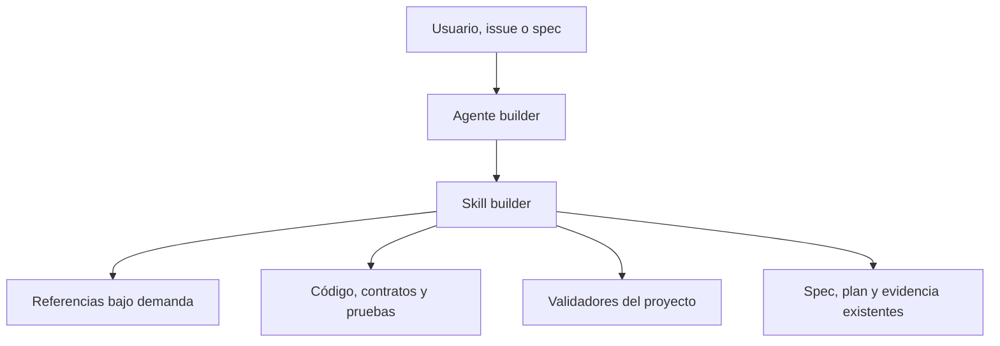

# Arquitectura y responsabilidades

## Modelo conceptual

| Concepto | Responsabilidad |
|---|---|
| Encargo | Intención y alcance autorizado por el usuario. |
| Especificación | Comportamiento, aceptación, preservación y restricciones. |
| Plan | Forma de modificar y validar el sistema. |
| Implementación | Código y artefactos que pertenecen al alcance. |
| Evidencia | Comprobación, revisión validada y resultado real. |
| Handoff | Trabajo fuera de Builder sin autorización implícita. |

La especificación define el comportamiento esperado y el repositorio demuestra el estado real. Builder conecta ambos mediante diseño, implementación y pruebas. SDD se aplica por cambio y no exige una herramienta o plantilla concreta.

## Componentes

El agente aporta identidad y herramientas. El skill contiene el proceso canónico. Las referencias se cargan solo cuando el modo o riesgo las necesita.

## Modos

| Modo | Resultado esperado |
|---|---|
| `feature` | Nueva capacidad solicitada y comprobada. |
| `extend` | Capacidad ampliada preservando contratos pertinentes. |
| `bugfix` | Defecto reproducido, corregido y protegido. |
| `refactor` | Estructura cambiada con comportamiento preservado. |
| `integrate` | Componentes conectados con contrato validado. |
| `explore` | Hallazgos y límites; no una feature terminada. |
| `resume` | Continuación reconciliada con el modo original. |

## Responsabilidades y fronteras

| Capacidad | Responsabilidad |
|---|---|
| `archi` | Arquitectura global y decisiones materiales. |
| `solution-baseline` | Baselines gobernadas y upgrades. |
| `builder` | Cambios concretos de aplicación y su validación. |
| `ranger` | Estrategia QA transversal. |
| `vulcano*` | DevSecOps, IaC, CI/CD, operación y despliegue. |

Builder conserva cambios ajenos, ownership y decisiones autorizadas. No ejecuta commit, push, merge, publicación o efectos remotos sin mandato aplicable. Consulte [fronteras y fuentes](../../skills/builder/references/boundaries-and-sources.md).
