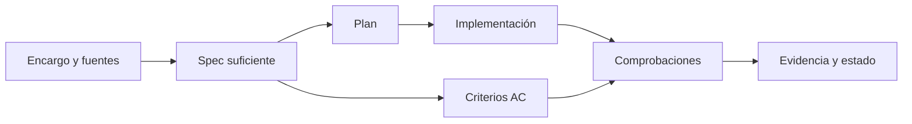

# Contratos y artefactos

Builder reutiliza el issue, OpenSpec, Spec Kit o expediente existente. Si un cambio estándar o reforzado necesita persistencia y no existe ubicación acordada, puede usar `docs/changes/<id>/spec.md`, con `plan.md` y `evidence.md` cuando separarlos aporte claridad o reanudación.

## Especificación mínima

| Campo | Contenido |
|---|---|
| Identidad y fuente | ID, intención, referencias y revisión. |
| Modo y rigor | Alcance y razón del nivel SDD. |
| Estado observado | Comportamiento real relevante. |
| Comportamiento deseado | Actores, precondiciones, resultados y errores. |
| Aceptación | Criterios comprobables, por ejemplo `AC-01`. |
| Preservación | Contratos y comportamientos que no deben cambiar. |
| Restricciones | Arquitectura, seguridad, datos, compatibilidad y UX. |
| Pendientes | Hechos, inferencias, propuestas y decisiones diferenciados. |

La spec define qué debe ocurrir; el plan define cómo. Una clase, tabla u operación CRUD no se convierte en requisito sin fuente.

## Evidencia

| Campo | Contenido |
|---|---|
| Criterio | IDs de aceptación o restricciones. |
| Comprobación | Test/comando o procedimiento reproducible. |
| Resultado | `passed`, `failed`, `not_run`, `blocked` o `not_applicable`. |
| Evidencia | Resultado observable sin secretos. |
| Contexto | Runtime, configuración y revisión validada. |

En un árbol sin commit, HEAD no identifica por sí solo lo validado: se usa el diff o hashes pertinentes. Un fake demuestra comportamiento local, no integración externa. Para APIs, eventos, workers o persistencia se identifica productor, consumidor, compatibilidad, ownership y secuencia. Consulte [contratos y datos](../../skills/builder/references/contracts-and-data.md) y [especificación y evidencia](../../skills/builder/references/spec-and-evidence.md).
