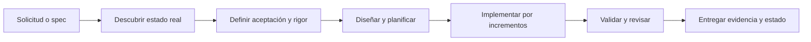

# Builder — documentación

Esta documentación explica la capacidad `builder` implementada en OCTO-HR: qué resuelve, cómo aplica SDD proporcional, cómo opera su agente, cómo conserva evidencia y cómo se evalúa. La fuente operativa es el [SKILL.md](../../skills/builder/SKILL.md) y la [guía rápida](../../skills/builder/README.md) resume su uso; el [agente Builder](../../agents/builder.agent.md) es una entrada explícita al mismo proceso.

## Objetivo

Builder convierte una solicitud, issue o especificación en un cambio verificable de una aplicación existente. Implementa funcionalidades, extensiones, bugs, refactors e integraciones; también puede explorar, planificar o reanudar esos cambios.

No define arquitectura global, crea baselines, diseña estrategia QA, crea skills o agentes, ni produce IaC o despliegues. Esas responsabilidades pertenecen a `archi`, `solution-baseline`, `ranger` y la familia `vulcano`.

## Estado actual

| Capacidad | Estado |
|---|---|
| Skill, modos y SDD proporcional | Implementado |
| Agente de entrada directa para Claude | Implementado |
| Adaptadores Codex, Copilot y Kiro | Diseñados; no presentes en este repositorio (solo `.claude/`) |
| Especificación y evidencia por cambio | Contrato documental flexible implementado |
| Instalador autocontenido | Implementado (`install_builder.py`) y verificable por hashes; el plugin de marketplace no está en este repositorio |
| Harness con 19 fixtures (Python, Go, Angular y Java) y routing | Implementado |
| Perfiles de stack Go, Angular, Java/Spring y Scaffold de Bancolombia | Implementados con toolkits y pruebas; las 15 pruebas que requieren Go, Java o Angular se omiten si el runtime no está instalado |
| Tablero de trabajo por MCP (Jira o Azure DevOps) | Implementado; opcional y no bloqueante |
| Revisión independiente con `code-review` | Integrada: recomendada en rigor estándar, obligatoria en reforzado |
| Campaña control/previous/candidate | Implementada; ejecuciones reales pendientes |
| Soporte universal de stacks | No acreditado; fuera de los perfiles, depende de los patrones del proyecto |

## Navegación

1. [Arquitectura y responsabilidades](./01-arquitectura-y-responsabilidades.md)
2. [Guía de uso](./02-guia-de-uso.md)
3. [Contratos y artefactos](./03-contratos-y-artefactos.md)
4. [Agente y paralelismo](./04-agentes-y-paralelismo.md)
5. [CLI y operación](./05-cli-y-operacion.md)
6. [Extensión y gobierno](./06-extension-y-gobierno.md)
7. [Validación, estado y troubleshooting](./07-validacion-y-estado.md)
8. [Inventario de implementación](./08-inventario-de-implementacion.md)
9. [Evaluación y release gates](./09-evaluacion-y-release-gates.md)

## Inicio rápido

```text
/builder corrige el cálculo de envío cuando el pedido tiene descuento
/builder implementa PROJ-123
/builder reanuda el cambio descrito en docs/changes/tax-calculation.md
```

También puede seleccionarse el agente `builder`. Ambas entradas cargan el mismo skill; no son dos procesos distintos.


