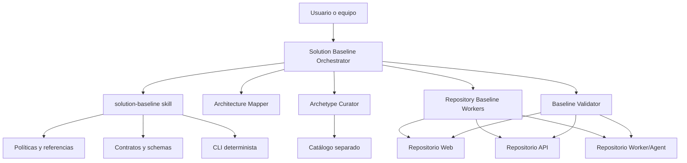

# Arquitectura y responsabilidades

## Modelo conceptual

`solution-baseline` separa cinco conceptos que no deben confundirse:

| Concepto | Responsabilidad | Ciclo de vida |
|---|---|---|
| Especificación arquitectónica | Declara lo que necesita la solución mediante decisiones y `ARQ-xxx` | Pertenece a arquitectura |
| Arquetipo | Patrón reusable, neutral, versionado y probado | Pertenece al catálogo |
| Capability | Comportamiento reusable y componible agregado a una familia | Se versiona con compatibilidad explícita |
| Overlay | Variación declarativa, acotada y ordenada | No debe convertirse en un fork silencioso |
| Baseline | Instancia concreta creada o reconciliada en un repositorio | Pertenece al proyecto y registra receipt |

El skill coordina y gobierna. Los generadores nativos o arquetipos materializan el código. Los agentes distribuyen el trabajo, pero no crean políticas alternativas.

## Componentes

## Responsabilidades organizacionales

| Capacidad | Hace | No hace |
|---|---|---|
| `archi` | Propone y aprueba arquitectura; resuelve `architecture-gap` | No materializa repositorios ni decide arquetipos publicados |
| `solution-baseline` | Descubre, normaliza, selecciona, planifica, instancia, reconcilia y registra | No desarrolla backlog ni despliega |
| Builder | Continúa con funcionalidades e historias de usuario | No redefine la baseline silenciosamente |
| Ranger | Revisa calidad y cumplimiento | No sustituye los gates del baseline |
| Vulcano | DevOps, IaC, empaquetado operacional y despliegue | No decide estructura interna de aplicación |
| Genesis | Traduce invocaciones históricas a `solution-baseline --mode create` | No conserva generador o políticas propias |

## Modos

| Situación | Modo | Efecto esperado |
|---|---|---|
| Inventario o diagnóstico | `discover` / `status` | Solo lectura |
| Preparación sin escritura | `plan` / `dry-run` | Artefactos de control y render temporal |
| Repositorio vacío | `create` | Instancia greenfield |
| Repositorio con código | `reconcile` | Cambios mínimos con ownership |
| Cambio de versión | `upgrade` | Migración y evaluación de drift |
| Brecha reusable demostrada | `archetype-create` | Candidato separado, aprobación y publicación |
| Varios repositorios | `orchestrate` / `resume` | DAG, leases, checkpoints y saga |

La estrategia se decide por repositorio. Una solución puede combinar Web brownfield con APIs greenfield y un worker pendiente, sin forzar una estrategia única.

## Estados de ejecución

El run manifest utiliza estados observables como `discovered`, `planned`, `rendered`, `reviewed`, `applying`, `validating`, `partial`, `blocked` y `completed`.

`completed` solo es válido cuando no existen pasos fallidos, bloqueados o parciales. Un fallo en un repositorio no obliga a eliminar resultados correctos de otros repositorios; la ejecución conserva checkpoints y puede reanudarse.

## Selección frente a creación de arquetipos

El orden obligatorio es:

1. Reusar una familia compatible y soportada.
2. Componerla con capabilities u overlays compatibles.
3. Crear un arquetipo reusable solo cuando exista una brecha generalizable.
4. Crear una baseline específica no promovida si el requisito es exclusivo del proyecto.

La palabra “arquetipo” en un documento no demuestra que exista una plantilla publicable. Primero se interpreta como una necesidad arquitectónica.

Si la arquitectura no define topología, límites, ownership, contratos, seguridad, estilo o stack con precisión suficiente, `solution-baseline` emite un `architecture-gap` validable y devuelve esa decisión a `archi`. Si la arquitectura sí está completa pero no existe un arquetipo compatible, el control permanece en `solution-baseline` para resolver reutilización, composición, creación reusable o baseline específica.

## Límites invariables

- Versiones efectivas exactas; `latest` está prohibido.
- Catálogo y repositorios de instancia físicamente separados.
- Arquetipos fijados por versión y digest o commit inmutable.
- Hooks deshabilitados por defecto y fuentes/licencias verificadas.
- Un solo writer por repositorio o zona disjunta.
- No se hacen commits, push, publicaciones o repositorios remotos sin autorización explícita.
- No se generan CI/CD, IaC, Dockerfiles operacionales, Helm, Kubernetes o despliegues.

Consulta las políticas fuente en [boundaries.md](../../skills/solution-baseline/references/boundaries.md), [modes.md](../../skills/solution-baseline/references/modes.md) y [security-and-trust.md](../../skills/solution-baseline/references/security-and-trust.md).
