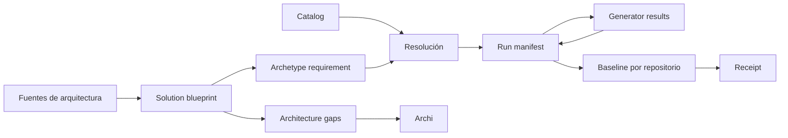

# Contratos y artefactos

## Relación entre artefactos



Los artefactos tienen ciclos de vida distintos. No debe usarse el blueprint como log de ejecución ni el run manifest como descripción arquitectónica permanente.

## Contratos disponibles

| Contrato | Schema | Plantilla | Función |
|---|---|---|---|
| Solution blueprint | `solution-blueprint.schema.json` | `solution-blueprint.template.yaml` | Estado deseado normalizado de la solución |
| Run manifest | `run-manifest.schema.json` | `run-manifest.template.yaml` | Estado transitorio, DAG, pasos y handoff de un run |
| Receipt | `receipt.schema.json` | `receipt.template.yaml` | Procedencia, ownership, drift y validaciones de una instancia |
| Catalog | `catalog.schema.json` | `catalog.template.yaml` | Familias publicadas, compatibilidad, permisos y migraciones |
| Archetype requirement | `archetype-requirement.schema.json` | `archetype-requirement.template.yaml` | Necesidad normalizada usada por el resolver |
| Generator result | `generator-result.schema.json` | `generator-result.template.yaml` | Respuesta estructurada e idempotente de un worker/adaptador |
| Adapter registry | `adapter-registry.schema.json` | Registro JSON real | Detección, workloads, motores y validaciones por stack |
| Architecture gap | `architecture-gap.schema.json` | `architecture-gap.template.yaml` | Devolución trazable de decisiones materiales a `archi` |
| Skill routing evaluation | `skill-evaluation.schema.json` | `skill-routing.yaml` | Casos positivos y negativos de activación del skill |
| Routing observations | `routing-observations.schema.json` | Evidencia de harness | Resultados observados sin fingir ejecución de modelo |
| Source verification | `source-verification.schema.json` | `source-verification.template.yaml` | Atestación recalculable de identidad, source y digest |
| Scope policy | `scope-policy.schema.json` | `assets/policies/scope-boundaries.yaml` | Frontera versionada frente a DevOps/IaC/despliegue |

Todos los schemas se encuentran en [assets/schemas](../../skills/solution-baseline/assets/schemas/) y las plantillas en [assets/templates](../../skills/solution-baseline/assets/templates/).

## Solution blueprint

Ruta convencional:

```text
resources/.solution-baseline/solution-blueprint.yaml
```

Contiene:

- identidad y descripción de la solución;
- fuentes con estado de evidencia;
- catálogos autorizados;
- componentes, workloads y repositorios;
- estrategia `create`, `reconcile` o `upgrade` por componente;
- stack y versiones solicitadas/resueltas;
- capabilities y dependencias;
- contratos compartidos;
- requisitos de seguridad y quality gates;
- decisiones y exclusiones.

La validación estricta exige componentes, versiones exactas resueltas y ausencia de decisiones pendientes que bloqueen la aplicación.

## Archetype requirement y catalog

El requirement declara workload, lenguaje, runtime, framework, estilo, capabilities, namespaces/sources autorizados, licencias, confianza, permisos y exclusiones aceptables.

El catálogo registra para cada arquetipo:

- familia, versión, estado y owner;
- fuente, licencia y digest inmutable;
- generador, versión y versión de contrato;
- rangos de compatibilidad;
- capabilities soportadas, requeridas o incompatibles;
- permisos;
- exclusiones;
- migraciones disponibles.

Los gates de confianza, licencia, permisos, integridad y exclusiones se aplican antes de puntuar compatibilidad. Un candidato inseguro no puede “ganar” por tener mejor coincidencia técnica.

## Run manifest

Ruta convencional:

```text
resources/.solution-baseline/runs/<run-id>/run-manifest.yaml
```

Registra:

- identidad y estado del run;
- hash y ruta del blueprint;
- resoluciones de catálogo;
- construcciones de arquetipo;
- instancias;
- leases;
- pasos idempotentes;
- decisiones y bloqueos;
- handoff.
- brechas arquitectónicas abiertas, resueltas o aceptadas.

La combinación `repository_id + operation + idempotency_key` identifica lógicamente un paso. Reutilizar la misma clave con otro input hash es un error.

El `dag` contiene nodos con `depends_on` y barreras con `release_nodes`. En modo estricto se rechazan IDs duplicados, referencias desconocidas, ciclos y nodos inconclusos dentro de un run marcado `completed`.

## Generator result

Cada worker o adaptador devuelve como mínimo:

- `operation`;
- `status`;
- `repository_id`;
- `idempotency_key`;
- artefactos;
- decisiones;
- warnings;
- evidencia;
- próximos pasos;
- contexto del agente;
- información de compensación cuando exista.

El orquestador agrega estos resultados al manifest mediante una escritura atómica.

## Receipt

Ruta convencional dentro de cada repositorio:

```text
.solution-baseline/receipt.yaml
```

Registra la versión aplicada, fuente, digest, generador, parámetros, capabilities, overlays, ownership, migraciones, drift aceptado y validaciones.

### Categorías de ownership

| Categoría | Semántica |
|---|---|
| `managed` | Puede regenerarse cuando no existe drift conflictivo |
| `extendable` | Solo se modifica en puntos declarados y mediante transformación segura |
| `project_owned` | Nunca se sobrescribe automáticamente |
| `generated_once` | Se crea una vez y luego pertenece al proyecto |
| `ignored` | No se inspecciona ni modifica salvo validación explícita |

## Validación

Ejemplo:

```powershell
python -B .claude/skills/solution-baseline/scripts/solution_baseline.py validate `
  --kind blueprint `
  --file resources/.solution-baseline/solution-blueprint.yaml `
  --strict
```

Tipos aceptados: `adapter`, `blueprint`, `catalog`, `receipt`, `requirement`, `result`, `run`, `handoff`, `gap` y `evaluation`.

La validación de schema confirma estructura. La opción `--strict` añade invariantes semánticos para blueprint, run, receipt, catalog y adapter. Las pruebas de compilación, ejecución y negocio siguen siendo obligatorias cuando correspondan.
