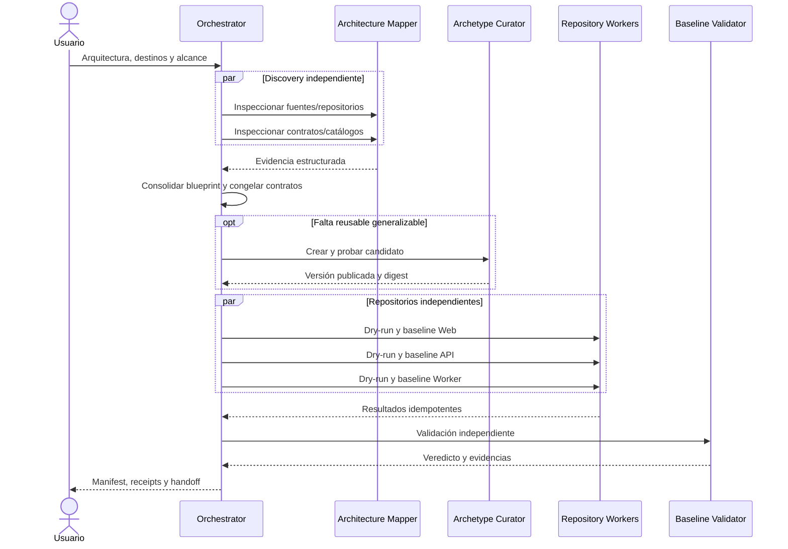

# Agentes y paralelismo

## Topología de agentes

| Agente | Rol principal | Escritura | Responsabilidad |
|---|---:|---|---|
| `solution-baseline-orchestrator` | Entrada coordinadora | Artefactos de control y coordinación | DAG, delegación, revisión, saga y handoff |
| `architecture-mapper` | Especialista delegado | Ninguna | Descubrimiento y normalización de evidencia |
| `archetype-curator` | Especialista delegado | Solo workspace de catálogo asignado | Crear o evolucionar candidatos reusables |
| `repository-baseline-worker` | Especialista delegado | Un repositorio o zona asignada | Create, reconcile o upgrade |
| `baseline-validator` | Especialista delegado | Artefactos efímeros en worktree | Veredicto independiente; nunca corrige código fuente |

Definiciones:

- [Solution Baseline Orchestrator](../../agents/solution-baseline-orchestrator.agent.md)
- [Architecture Mapper](../../agents/architecture-mapper.agent.md)
- [Archetype Curator](../../agents/archetype-curator.agent.md)
- [Repository Baseline Worker](../../agents/repository-baseline-worker.agent.md)
- [Baseline Validator](../../agents/baseline-validator.agent.md)

Todos deben leer el [SKILL.md](../../skills/solution-baseline/SKILL.md). Las definiciones de agente contienen responsabilidades y límites, no una copia de las políticas tecnológicas.

Claude Code descubre las definiciones Markdown bajo `.claude/agents/`, con nombres kebab-case, herramientas nativas y precarga del skill. Codex descubre los adaptadores TOML bajo `.codex/agents/` y el wrapper de skill bajo `.agents/skills/solution-baseline/`. Ambos apuntan a la misma implementación canónica para evitar drift.

## Instalación y verificación

El plugin no depende de una ruta `.claude/skills/solution-baseline`. Al cargarlo, `<skill-root>` es el directorio real que contiene su `SKILL.md`:

```powershell
python "<skill-root>/scripts/solution_baseline.py" agents install `
  --project-root <repo> `
  --platform codex claude `
  --configure-runtime

python "<skill-root>/scripts/solution_baseline.py" agents check `
  --project-root <repo> `
  --platform codex claude
```

La instalación valida metadata, evita sobrescribir definiciones diferentes y registra hashes en `.solution-baseline/agent-installation.json`. Para Codex configura un máximo de cuatro hilos de subagente, sin contar el principal. Un límite preexistente diferente exige revisión explícita.

## Flujo del orquestador



## Cuándo paralelizar

Se puede paralelizar:

- discovery de solo lectura;
- render y validación de repositorios sin dependencia entre sí;
- validaciones independientes en worktrees aislados;
- instancias consumidoras después de publicar y fijar el arquetipo;
- trabajos sobre zonas con ownership realmente disjunto.

Debe permanecer secuencial:

- consolidación y aprobación del blueprint;
- congelamiento de contratos compartidos;
- construcción, aprobación y publicación de un arquetipo antes de consumirlo;
- aplicación sobre un mismo repositorio o zona;
- consolidación final del manifest y handoff.

## Límites ejecutables

La política [concurrency-limits.yaml](../../skills/solution-baseline/assets/policies/concurrency-limits.yaml) establece:

| Recurso | Máximo |
|---|---:|
| Subagentes activos | 4 |
| Readers activos | 4 |
| Writers activos | 2 |
| Writers por repositorio | 1 |
| Writers del catálogo | 1 |

Antes de delegar, el orquestador materializa una ola con la plantilla `agent-assignments.template.yaml` y ejecuta `check-concurrency`. Los estados `scheduled` y `running` consumen capacidad. Un límite menor del runtime siempre prevalece.

Antes de iniciar un rol mutable ejecuta `verify-workspace`. Por defecto exige un worktree Git enlazado al checkout principal, pero con una raíz distinta. Worker y validator sobre el mismo repositorio se ejecutan en olas diferentes.

## Ownership y leases

Cada unidad de escritura tiene exactamente un owner durante una fase. El CLI implementa leases locales con expiración:

```powershell
python -B .claude/skills/solution-baseline/scripts/solution_baseline.py lease acquire `
  --file resources/.solution-baseline/leases/web.json `
  --owner web-worker `
  --resource apps/web `
  --ttl-seconds 900
```

Un segundo owner no puede adquirir un lease vigente. El mismo owner puede renovarlo y un lease expirado puede recuperarse de forma registrada.

## Saga y fallos parciales

Una ejecución multi-repositorio no simula una transacción distribuida. Usa una saga:

- pasos idempotentes;
- input hashes;
- checkpoints;
- resultado por repositorio;
- compensación solo cuando sea segura;
- estado `partial` cuando existen éxitos y fallos;
- `resume` desde pasos pendientes o fallidos.

No se eliminan repositorios correctos para aparentar atomicidad.

## Repositorios diferentes

El agente puede trabajar con varios repositorios locales o worktrees y puede coordinar repositorios remotos si recibe autoridad explícita. La creación remota, publicación, push o apertura de PR no se infieren a partir de una solicitud de baseline.

Para cada repositorio deben quedar congelados:

- identificador y ruta;
- estrategia;
- owner/writer;
- arquetipo, versión y digest;
- dependencias del DAG;
- contratos consumidos o producidos;
- quality gates;
- receipt propio.

## Wrapper de delegación

El orquestador debe entregar a cada especialista entradas cerradas: modo, repositorio, ownership, blueprint, contratos, resolución de catálogo, permisos, idempotency key y formato de resultado. Los workers no deben decidir por su cuenta topología global, publicar arquetipos o modificar el manifest central.
