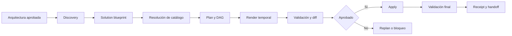

# Solution Baseline — documentación

Esta documentación explica la capacidad `solution-baseline` implementada en OCTO-HR: qué resuelve, cómo se opera, cuáles son sus contratos, cómo colaboran sus agentes y qué falta para convertirla en una plataforma de arquetipos plenamente operativa.

## Objetivo

`solution-baseline` transforma una arquitectura aprobada en líneas base de aplicación reproducibles y listas para desarrollo. Soporta frontend, API, worker, agent service e integraciones en escenarios greenfield, brownfield, híbridos y multi-repositorio.

No implementa historias de negocio y no genera DevOps, IaC, contenedores operacionales ni despliegues. Esas responsabilidades pertenecen a Builder y Vulcano respectivamente.

## Estado actual

| Capacidad | Estado |
|---|---|
| Skill y políticas de ejecución | Implementado |
| Modos greenfield, brownfield, upgrade y orquestación | Especificados |
| Contratos JSON Schema y plantillas YAML | Implementados |
| CLI determinista para inspección, validación y control | Implementado |
| Registro inicial de ocho adaptadores | Implementado |
| Agente orquestador y cuatro especialistas | Implementados, instalables y verificables para Claude Code y Codex |
| Handoff formal de brechas a `archi` | Implementado |
| Evaluaciones de routing y pruebas adversariales | Harness contractual implementado; observaciones reales pendientes |
| Compatibilidad de Genesis | Implementada como alias obsoleto |
| Plugin portable del skill y adaptadores | Implementado sin marketplace; rutas relativas al skill, instalación y sincronización verificables |
| Arquetipos ejecutables publicados | Pendiente |
| Golden projects por arquetipo | Pendiente |
| Adopción requerida para retirar Genesis | `0/2` proyectos/equipos |

La equivalencia de Genesis es actualmente contractual. No debe interpretarse como evidencia de que ya existan arquetipos ejecutables y publicados para todos los workloads.

## Navegación

1. [Arquitectura y responsabilidades](./01-arquitectura-y-responsabilidades.md)
2. [Guía de uso](./02-guia-de-uso.md)
3. [Contratos y artefactos](./03-contratos-y-artefactos.md)
4. [Agentes y paralelismo](./04-agentes-y-paralelismo.md)
5. [CLI y operación](./05-cli-y-operacion.md)
6. [Extensión y gobierno](./06-extension-y-gobierno.md)
7. [Validación, estado y troubleshooting](./07-validacion-y-estado.md)
8. [Inventario de implementación](./08-inventario-de-implementacion.md)
9. [Evaluación y release gates](./09-evaluacion-y-release-gates.md)

## Inicio rápido

Desde la raíz del repositorio:

```powershell
python -m pip install -r .claude/skills/solution-baseline/scripts/requirements.txt
python -B .claude/skills/solution-baseline/scripts/solution_baseline.py --help
python -B .claude/skills/solution-baseline/scripts/solution_baseline.py inspect --root apps/web
python -B .claude/skills/solution-baseline/scripts/test_solution_baseline.py -v
```

Para ejecutar el proceso completo mediante un agente, usa `solution-baseline-orchestrator` y proporciona las fuentes arquitectónicas, destinos y alcance. Para una tarea pequeña puede invocarse `$solution-baseline` directamente.

## Flujo de referencia



Toda escritura debe respetar este orden:

```text
inspect → plan → render temporal → validate → diff → review/approve → apply → validate → receipt
```

## Fuentes de verdad

En orden de responsabilidad:

1. La arquitectura aprobada define el estado deseado.
2. Los contratos ejecutables, como OpenAPI o AsyncAPI, concretan integraciones.
3. El repositorio demuestra el estado real y determina `create` frente a `reconcile`.
4. El solution blueprint normaliza la decisión para una solución.
5. El catálogo versionado gobierna los arquetipos reusables.
6. El run manifest registra la ejecución.
7. El receipt de cada repositorio registra procedencia, ownership y drift.

La fuente operativa principal es el [SKILL.md](../../skills/solution-baseline/SKILL.md). El diseño y roadmap se encuentran en [Plan y diseño de Solution Baseline](../../../resources/architecture/27-Plan-y-Diseno-Solution-Baseline.md).
