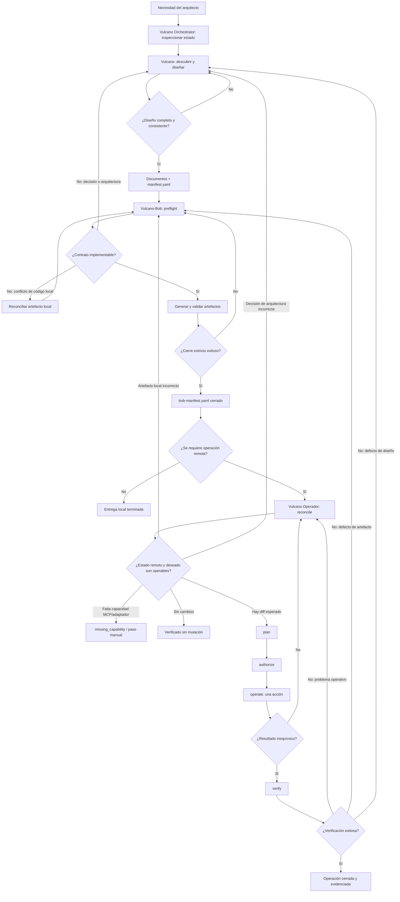

# Agentes y paralelismo

## Agentes dedicados

El ecosistema tiene cuatro agentes top-level: tres especialistas asociados a una skill y un
orquestador sin skill propia:

| Agente | Skill | Responsabilidad | Límite principal |
|---|---|---|---|
| [`vulcano-orchestrator`](../../agents/vulcano-orchestrator.agent.md) | No aplica | Coordinar definición, generación local, validación y reanudación | No escribe directamente ni invoca al operador. |
| [`vulcano`](../../agents/vulcano.agent.md) | `vulcano` | Definición documental | No genera ni opera. |
| [`vulcano-bob`](../../agents/vulcano-bob.agent.md) | `vulcano-bob` | Generación y validación local en worktree | No redecide ni opera. |
| [`vulcano-operador`](../../agents/vulcano-operador.agent.md) | `vulcano-operador` | Reconciliación y acción remota autorizada | No aplica Terraform ni amplía el alcance. |

Los tres especialistas aplican su propio ciclo y devuelven un handoff verificable. El
orquestador añade continuidad y reanudación, pero no funciona como writer ni como fuente
de decisiones. No existen workers paralelos como los de `solution-baseline`.

La coordinación es el workflow secuencial con retroalimentación descrito a
continuación: un handoff estricto por manifiestos y gates humanos, sin ejecución
concurrente de componentes ni de instancias de un mismo componente. El orquestador
puede invocar Vulcano y Bob; `vulcano-operador` declara `disable-model-invocation: true`,
debe iniciarlo el usuario y el cierre de Bob no constituye autorización remota.

## Workflow detallado

## Flujo explicado

0. **Vulcano Orchestrator inspecciona y reanuda.** Resuelve alcance y `resources_root`,
   lee los manifiestos y comienza en la primera fase no cerrada o con hashes obsoletos.
   No crea un manifiesto propio ni edita los artefactos de los especialistas.

1. **Vulcano inicia el proceso.** Inspecciona la arquitectura, documentación y código
   antes de preguntar; luego acuerda el alcance y genera los documentos de DevOps, IaC y
   observabilidad uno por uno. Cuando el diseño está listo, entrega el control a
   Vulcano-Bob. No genera Terraform ni registra pipelines remotos. Su gate de salida se
   detalla en [Extensión y gobierno](./06-extension-y-gobierno.md#gates-de-salida).

2. **Vulcano-Bob recibe y comprueba el diseño.** No comienza generando archivos: primero
   ejecuta el preflight. Si falta una decisión o el contrato es arquitectónicamente
   imposible, marca `conflict` y devuelve el caso a Vulcano, que corrige la
   decisión/documento antes de que Bob repita el preflight. Si el problema es únicamente
   de implementación local (por ejemplo, un archivo generado desactualizado pero con
   diseño válido), Bob lo reconcilia dentro de su propio ciclo, sin hacer que Vulcano
   redefina arquitectura.

3. **Vulcano-Bob genera y valida localmente.** Con el preflight en `ready`, genera
   bootstrap, módulos, ambientes y pipelines en orden de dependencias; cada artefacto se
   valida con herramientas reales y conserva hashes de sus fuentes. Bob puede terminar
   aquí si solo se pidió generación local: "generado" no significa "aplicado",
   "registrado" ni "desplegado".

4. **Vulcano-Bob transfiere a Vulcano-Operador.** Si el usuario pidió trabajar sobre una
   plataforma remota, Bob transfiere explícitamente a Operador; la primera fase siempre
   es `reconcile` y el cierre de Bob no autoriza ninguna mutación por sí mismo. Operador
   verifica el cierre estricto y hash actual de Bob, los adaptadores de plataforma y
   cloud, las coordenadas del target, la disponibilidad de los MCP necesarios y el
   estado remoto observado mediante una lectura sanitizada.

5. **Vulcano-Operador reconcilia y decide la ruta.** La reconciliación puede producir
   varios resultados:

   | Resultado | Siguiente paso |
   |---|---|
   | Estado remoto ya coincide | Registrar verificación; no mutar. |
   | Existe un diff esperado y soportado | Crear una acción mínima en `plan`. |
   | El artefacto local de Vulcano-Bob es incorrecto | Volver a Vulcano-Bob, corregir, cerrar y reconciliar otra vez. |
   | La decisión o contrato de Vulcano es incorrecto | Volver a Vulcano; después repetir Vulcano-Bob y Vulcano-Operador. |
   | Falta MCP o adaptador | Registrar `missing_capability`; usar un paso manual aprobado o construir la capacidad. |

6. **Vulcano-Operador aplica el ciclo de seguridad.** Para un diff válido, el flujo
   `reconcile → plan → authorize → operate → verify` es obligatorio (fases y garantías
   detalladas en [Extensión y gobierno](./06-extension-y-gobierno.md#gates-de-salida)).
   Si una ejecución devuelve timeout o un resultado ambiguo, no reintenta inmediatamente:
   vuelve a `reconcile`. Si la verificación revela un defecto de artefacto, retroalimenta
   a Vulcano-Bob; si revela un problema en la decisión, retroalimenta a Vulcano.

## Ciclos de retroalimentación

| Hallazgo | Responsable de corregir | Razón | Reinicio del flujo |
|---|---|---|---|
| Decisión ausente, contradictoria o no implementable | Vulcano | El contrato de arquitectura es su responsabilidad. | Vulcano → Vulcano-Bob preflight. |
| Cambio aprobado en ambientes, módulos, CI/CD o observabilidad | Vulcano | Debe actualizar documentos y `manifest.yaml`. | Vulcano → Vulcano-Bob genera/valida de nuevo. |
| Archivo local incompleto, obsoleto o inválido | Vulcano-Bob | El diseño es correcto; falló su materialización. | Vulcano-Bob preflight → generación → cierre. |
| Hash de una fuente Vulcano cambió | Vulcano-Bob revisa; Vulcano interviene si cambió la decisión | La evidencia de validación anterior quedó obsoleta. | Preflight y renovación de hashes. |
| Estado remoto difiere legítimamente del deseado | Vulcano-Operador | Es un diff operacional soportado. | Plan → authorize → operate → verify. |
| Resultado remoto ambiguo o cambio concurrente | Vulcano-Operador | Se necesita una nueva lectura antes de decidir. | Volver a reconcile. |
| Artefacto deseado no funciona en la plataforma | Vulcano-Bob | Debe corregirse la implementación local sin redefinir el contrato. | Vulcano-Bob → cierre → Vulcano-Operador reconcile. |
| El target o mecanismo aprobado no es viable | Vulcano | Exige cambiar una decisión de arquitectura. | Vulcano → Vulcano-Bob → Vulcano-Operador. |
| Falta adaptador o herramienta MCP | Backlog de capacidad / owner de plataforma | No se permite improvisar un canal operativo. | Pausa o paso manual autorizado. |

La retroalimentación no es un ciclo autónomo infinito. Cada vuelta debe producir un
cambio trazable en un documento, artefacto, manifiesto, capacidad o estado remoto, y
volver a pasar sus gates correspondientes.
