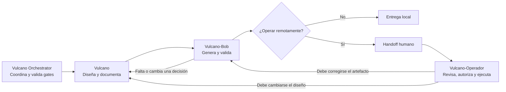

# Vulcano — documentación del ecosistema

Este documento es la puerta de entrada al ecosistema Vulcano. Vulcano, Vulcano-Bob y
Vulcano-Operador se especializan y se transfieren el control mediante manifiestos
verificables. Son tres skills con tres agentes de fase y un cuarto agente orquestador;
mantienen entradas, salidas y gates propios, no alias de un único agente.

## Objetivo

El ecosistema Vulcano diseña, materializa localmente y opera de forma remota una
estrategia verificable de DevSecOps, CI/CD, infraestructura como código y
observabilidad, en tres pasos secuenciales:

```text
Vulcano decide → Vulcano-Bob construye → Vulcano-Operador aplica y verifica.
```

Vulcano no genera Terraform ni registra pipelines remotos. Vulcano-Bob no decide
arquitectura ni opera sistemas remotos. Vulcano-Operador nunca aplica Terraform ni crea
por MCP recursos administrados por IaC, y solo muta después de una autorización humana
explícita por acción.

## Estado actual

| Capacidad | Estado |
|---|---|
| Skill Vulcano (diseño DevSecOps/IaC/observabilidad) | Implementado |
| Skill Vulcano-Bob (generación y validación local) | Implementado |
| Skill Vulcano-Operador (reconciliación y operación remota) | Implementado |
| Validador de `manifest.yaml` (Vulcano) | Implementado — suite de fixtures 37/37 (2026-09-10) |
| Validador y renderers de `bob-manifest.yaml` (Vulcano-Bob) | Implementado — 13/13 + 6/6 + 24/25 + 8/8 + 3/3 pruebas (2026-09-10) |
| Validador de `operations-manifest.yaml` (Vulcano-Operador) | Implementado — 13/13 pruebas (2026-09-10) |
| Adaptadores cloud de Bob (Azure, AWS, GCP) | Implementados |
| Adaptador IaC de Bob (Terraform) | Implementado |
| Adaptadores de pipeline de Bob (Azure DevOps, GitHub Actions, GitLab) | Implementados |
| Adaptador GitOps ArgoCD en Bob (generación local de Kustomize/Applications) | Implementado |
| Adaptador ChatOps Slack en Bob | `planned`, no operativo |
| Adaptadores de plataforma de Operador (Azure DevOps, GitHub Actions, GitLab) | Implementados |
| Adaptadores cloud de Operador (Azure, AWS, GCP) | Implementados, solo lectura |
| Adaptador operativo GitOps ArgoCD en Operador | `planned` — Bob genera los manifiestos, pero Operador aún no reconcilia/sincroniza contra el clúster |
| Adaptador ChatOps Slack en Operador | `planned`, no operativo |
| Swap del step de deploy en GitOps (renderers GitHub Actions/GitLab de Bob) | Bug conocido — `bob-state-scripts.test.mjs` falla 1/25 |
| Agentes dedicados `.claude/agents/vulcano*` | 4 implementados: un orquestador y tres agentes de fase |

Este repositorio no tiene sesiones reales activas (`resources/.vulcano/manifest.yaml`,
`bob-manifest.yaml` u `operations-manifest.yaml`), por lo que el estado "Implementado"
se sostiene en las suites de regresión de cada componente, no en un cierre end-to-end
sobre un proyecto concreto. Ver [Validación y estado](./07-validacion-y-estado.md).

## Navegación

1. [Arquitectura y responsabilidades](./01-arquitectura-y-responsabilidades.md)
2. [Guía de uso](./02-guia-de-uso.md)
3. [Contratos y artefactos](./03-contratos-y-artefactos.md)
4. [Agentes y paralelismo](./04-agentes-y-paralelismo.md)
   - [Contrato de Vulcano Orchestrator en `docs/`](../../../docs/agents/vulcano-orchestrator.md)
5. [CLI y operación](./05-cli-y-operacion.md)
6. [Extensión y gobierno](./06-extension-y-gobierno.md)
7. [Validación y estado](./07-validacion-y-estado.md)
8. [Inventario de implementación](./08-inventario-de-implementacion.md)
9. [Evaluación y release gates](./09-evaluacion-y-release-gates.md)

## Inicio rápido

Desde la raíz del repositorio, el cierre de cada componente se valida con:

```powershell
node .claude/skills/vulcano/scripts/validate-vulcano.mjs --strict-completeness

node .claude/skills/vulcano-bob/scripts/validate-vulcano-bob.mjs `
  --strict-completeness --write-summary

node .claude/skills/vulcano-operador/scripts/validate-operations-manifest.mjs --strict
```

Para ejecutar definición y generación local como un único flujo, seleccione
`vulcano-orchestrator`. También puede invocar por separado `vulcano`, `vulcano-bob` y
`vulcano-operador`, o usar sus skills homónimas; ver
[Ejemplos de invocación](./02-guia-de-uso.md#ejemplos-de-invocación). El operador siempre
debe ser iniciado por el usuario.

## Flujo de referencia



Toda escritura remota debe respetar este orden:

```text
manifest.yaml (Vulcano) → bob-manifest.yaml (Vulcano-Bob, cierre estricto) →
reconcile → plan → authorize → operate → verify (Vulcano-Operador)
```

El workflow detallado, con todas las bifurcaciones de retroalimentación, está en
[Agentes y paralelismo](./04-agentes-y-paralelismo.md).

## Fuentes de verdad

En orden de responsabilidad:

1. La arquitectura aprobada y la evidencia real del repositorio definen el punto de partida de Vulcano.
2. `resources/.vulcano/manifest.yaml` registra las decisiones, supuestos, pendientes y omisiones de Vulcano.
3. `resources/.vulcano/bob-manifest.yaml` registra el cierre estricto, hashes y evidencia de Vulcano-Bob.
4. `resources/.vulcano/operations-manifest.yaml` registra las operaciones remotas autorizadas y verificadas de Vulcano-Operador.
5. Las fuentes operativas principales son [vulcano/SKILL.md](../../skills/vulcano/SKILL.md), [vulcano-bob/SKILL.md](../../skills/vulcano-bob/SKILL.md) y [vulcano-operador/SKILL.md](../../skills/vulcano-operador/SKILL.md).

`vulcano-orchestrator` no añade un manifiesto ni una fuente de verdad: deriva el estado desde los
manifiestos anteriores y conserva la autoridad de cada especialista.

Un conflicto entre estas fuentes vuelve siempre al componente que posee la decisión o el
artefacto; nunca se resuelve sobrescribiendo silenciosamente una fuente.
