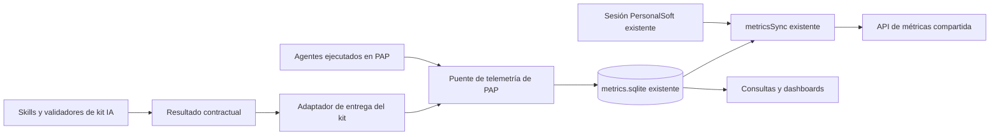

# Telemetría de kit IA reutilizando la infraestructura de PAP

Propuesta revisada el 5 de octubre de 2026. Kit IA define y valida las mediciones de sus capacidades, y utiliza la infraestructura de PAP para persistir y enviar. Se conserva una sola base en `%APPDATA%\pap\metrics\metrics.sqlite`, la autenticación de PersonalSoft y el sincronizador existente. El origen de cada ejecución permanece identificado como PAP, terminal u otro host.

Esta propuesta reemplaza la creación de `%APPDATA%\kit-ia\telemetry`, una base independiente, un importador de histórico y un segundo cliente de autenticación. El histórico existente continúa en su ubicación actual.

## Qué se reutiliza

| Componente existente | Uso propuesto |
|---|---|
| `metricsStore.ts` y `metrics.sqlite` | Persistencia única; ampliar el esquema donde el contrato del kit lo requiera |
| `psAuthClient.ts` y almacén seguro de PAP | Login corporativo, sesión y renovación existentes |
| `metricsSync.ts` | Transporte, gestión de pendientes, diagnóstico y confirmación del receptor |
| `periodicMetricsSync.ts` | Reintentos periódicos mientras el proceso de PAP esté activo |
| API de métricas actual | Receptor compartido con un contrato compatible que conserve origen y resultados |
| Consultas y dashboards de PAP | Presentación del mismo histórico con filtros por host y capacidad |
| Validadores de kit IA | Cálculos QA, condiciones de cierre, evidencia y resultados normalizados |

La captura de consumo ya existe en los proveedores Claude y Copilot de PAP. Debe conectarse con la persistencia en el proceso principal antes de reenviar eventos al renderer, para que una recarga de la interfaz no pierda las observaciones.

La lectura local anterior encontró 352 eventos, 118 turnos y 468 registros de herramientas. De los turnos, 104 de Claude tienen tokens de entrada/salida y no duración registrada; 14 de Copilot tienen duración y no tokens registrados. Son datos del histórico leído, no una garantía de cobertura completa. Los datos ausentes continúan siendo desconocidos.

## Separación de responsabilidades

| Responsabilidad | Dueño |
|---|---|
| Contratos de capacidades, significado de métricas y cálculos con evidencia | Kit IA |
| Validación y producción del resultado de cada skill | Kit IA |
| Adaptador que entrega resultados a PAP desde otro entorno | Kit IA |
| Identidad de corridas e invocaciones y contexto observado | Host o puente local, mediante código; nunca el modelo |
| Escritura en SQLite, autenticación y transporte | Infraestructura existente de PAP |
| Estado de envío, consultas y UI | PAP, conservando las dimensiones del kit |

El kit queda aislado del detalle de Electron y de la base mediante un contrato de entrega local. El backend de telemetría inicial depende de PAP instalado. Esto conserva la independencia de las reglas de medición, pero no ofrece envío remoto en una máquina sin los componentes de PAP. Un futuro backend alternativo implementaría el mismo contrato; no forma parte del primer alcance.

## Un solo escritor de la base

PAP usa `sql.js`: mantiene la base en memoria y la reexporta completa al guardar. Su bloqueo de instancia única existe precisamente para evitar que dos procesos sobrescriban las filas del otro. Un CLI del kit que escribiera directamente con SQLite podría perder datos aunque ambos archivos fueran compatibles.

Toda escritura debe pasar por el proceso dueño de `metricsStore`. Kit IA invoca un puente de telemetría de PAP; el puente valida la solicitud, registra mediante el almacenamiento existente y confirma solo después de persistir. Las solicitudes concurrentes se serializan. El transporte local utiliza un mecanismo protegido por los permisos del usuario, con validación de mensajes y límites de tamaño; no abre un endpoint público ni expone credenciales.

## Uso desde terminal con la ventana cerrada

Añadir a PAP un modo de telemetría sin interfaz. El ejecutable instala y utiliza los mismos módulos de almacenamiento, autenticación y envío. Si PAP ya está abierto, entrega la solicitud a la instancia dueña de la base. Si está cerrado, inicia ese mismo backend sin crear una ventana de chat.

El código actual de `second-instance` enfoca la ventana y no procesa solicitudes externas; debe ampliarse. También debe permitir que una apertura normal de PAP cree la UI sobre una instancia que se inició en modo telemetría, conservando el mismo escritor. No lanzar un segundo proceso que abra otra copia en memoria de la base.

El adaptador del kit inicia el puente al recibir un resultado o un evento capturable y le entrega JSON tipado. Si la entrega falla, el resultado de la skill permanece en la carpeta contractual del proyecto y puede reenviarse con la misma identidad. Eso reutiliza el artefacto de trabajo; no crea una segunda base ni otra cola de métricas. Las observaciones efímeras de consumo requieren acuse local o deben quedar marcadas como brecha de captura si el puente no las recibió.

La operación sin interfaz usa la sesión PersonalSoft de PAP mediante sus propios módulos. Si esa sesión no existe o fue revocada, conserva los registros ya persistidos y devuelve `authentication_required`. El login interactivo se ejecuta expresamente con el flujo existente de PAP; el proceso en segundo plano no abre ventanas por cada reintento. No copiar `session.enc` al kit ni intentar descifrarlo desde Python.

## Origen y contrato de entrega

El origen de ejecución es distinto del componente que guarda o envía. Cada solicitud conserva `hostId`, cliente de IA, proveedor, agente, capacidad y contexto corroborado cuando esté disponible.

| Trabajo ejecutado | Origen | Backend de persistencia y envío |
|---|---|---|
| Desde la interfaz de PAP | `pap` | PAP |
| Desde Claude Code en terminal | `terminal` | PAP |
| Desde otro host integrado | ID del host | PAP |
| Histórico previo generado por PAP | `pap`, con procedencia histórica | PAP |
| Sin evidencia suficiente de origen | `unknown` | PAP |

El ejecutable que transporta, la carpeta `%APPDATA%\pap`, la cuenta autenticada y el nombre del servicio remoto no convierten una ejecución de terminal en PAP. El origen se fija desde la integración de ejecución y se conserva en almacenamiento, exportación y filtros de dashboard. No se deduce del texto del modelo.

La interfaz local prevista incluye registrar un encargo, recibir consumo observado, recibir un resultado contractual y consultar el estado de persistencia/envío. Los mensajes tienen versión e identidad estable. Reentregar el mismo mensaje no duplica; repetir una identidad con contenido distinto genera conflicto o una revisión explícita.

Para los resultados QA, reutilizar `validate.py` y `validate_run.py` del kit. Registrar también versión del kit y del validador. El esquema actual permite valores numéricos, categorías, booleanos y desconocidos, así como numeradores, denominadores y evidencia. No reducir todo a `metrica` y `valor REAL` si eso pierde información.

## Claude Code y GitHub Copilot

El kit distribuye adaptadores para cada cliente soportado, además de sus contratos comunes. Los hooks de Claude Code no constituyen por sí solos la integración de Copilot. Registrar por separado host de ejecución, cliente de IA, proveedor y modelo observado: Copilot ejecutado en PAP conserva `hostId: pap`; Copilot CLI directamente conserva `hostId: terminal`; una sesión local de Copilot en VS Code conserva `hostId: vscode`.

Dentro de PAP, reutilizar `copilotProvider.ts`, que ya emite `turn_usage` y trata de extraer tokens y créditos del texto del CLI. Ese parser no garantiza disponibilidad: los 14 turnos Copilot del histórico local leído tienen duración y no tokens. Probarlo contra la versión instalada y conservar datos ausentes como desconocidos, sin estimarlos a partir del texto o del número de herramientas.

Fuera de PAP, añadir al kit configuración e instalador de hooks Copilot CLI en `.github/hooks/*.json`, incluyendo eventos de sesión y cierre del agente según la versión compatible. Los callbacks recogen resultados contractuales y entregan al mismo puente local de PAP. Los datos de consumo solo se añaden cuando una fuente compatible realmente los expone; disponer de un hook de cierre no demuestra acceso a tokens.

Para VS Code, distinguir sesiones Local y Copilot sobre Agent Host. La documentación actual indica que Agent Host comparte implementación de hooks con Copilot CLI; las sesiones Local tienen su propio contrato. Configurar y probar adaptadores apropiados para ambos. Los hooks de VS Code están documentados como Preview, por lo que instalación, política y versión forman parte de la matriz de compatibilidad. La captura cubre esas sesiones de agente; no promete medir autocompletado inline ni todo uso de Copilot.

Cuando PAP ejecute un cliente que también tenga hooks, fijar un único productor de consumo para esa ejecución o compartir identidades observables para deduplicar. Los resultados de capacidades se entregan una vez por invocación/revisión. La misma regla aplica a Claude y Copilot.

Referencias: [hooks de Copilot CLI](https://docs.github.com/en/copilot/reference/hooks-reference) y [hooks de VS Code](https://code.visualstudio.com/docs/agent-customization/hooks).

## Cambios mínimos en la base existente

Agregar mediante migración los campos de procedencia e identidad a los registros aplicables, y tablas de invocaciones/resultados dentro del mismo `metrics.sqlite` cuando hagan falta para conservar el contrato completo. La forma final se decide con los contratos del receptor y las consultas existentes. Una base compartida puede tener varias tablas; no requiere guardar todo en una sola fila heredada.

Conservar resultado original y normalizado según la política local, con referencias a evidencia. La exportación remota selecciona explícitamente los campos permitidos; no envía automáticamente prompts, resúmenes, rutas o credenciales. Los resultados contractuales del proyecto siguen siendo los artefactos de las skills.

Mantener el cursor y la gestión de pendientes existentes, extendiéndolos para los nuevos tipos de registro. Solo avanzar lo confirmado por el receptor. Las políticas actuales de purga y límites deben revisarse para que no eliminen datos pendientes silenciosamente; cualquier descarte por retención queda diagnosticado. El acuse local significa guardado, no enviado.

El estado técnico del proceso, el cumplimiento del encargo y la recomendación QA siguen separados. Un reporte completo con `NO-GO` conserva ambos hechos. Una skill aplicada dentro del agente principal no recibe tokens propios salvo evidencia observable de atribución; el consumo permanece en su turno o proceso real.

## Cuándo se envía

Reutilizar los disparadores de PAP: inicio, timer periódico, recuperación de sesión, acción manual y cierre. El puente puede solicitar además un intento asíncrono tras persistir nuevos resultados, agrupando solicitudes para no crear un POST por cada métrica.

Con PAP en modo telemetría, el timer periódico utiliza el mismo sincronizador. Si se opta por cerrar el backend después de cada operación, los reintentos ocurren al próximo arranque, evento o solicitud manual. Para reintentar sin ningún proceso abierto puede configurarse una tarea periódica que invoque el mismo ejecutable de PAP en modo sincronización; no es otro enviador ni usa otra base. No crear esa tarea durante la propuesta.

La entrega requiere red, sesión válida y receptor disponible. Guardar y reintentar conserva los pendientes hasta los límites de retención; no promete envío con la máquina apagada o una sesión revocada.

## Compatibilidad con el receptor

Los checkouts revisados divergen: el emisor de desktop-agent produce líneas con `tipo_evento`, mientras el checkout de pap-metrics-api valida `record_type: agent_run | agent_metric`. Ambos tienen un número de versión 2 con formas distintas. El cursor local registra un envío exitoso, pero no demuestra compatibilidad entre esos checkouts ni identifica el contrato desplegado.

Antes de integrar, comprobar el contrato real del receptor y acordar una versión que conserve host, invocación, capacidad y métricas con sus tipos. El contrato `agent_run` revisado no declara host y `agent_metric` exige un valor numérico. Ampliar coherentemente el emisor y el receptor existentes; reutilizar la API no significa forzar todos los datos del kit a su forma anterior. Hasta disponer de soporte, los registros de otros hosts quedan pendientes y nunca se etiquetan como PAP para aceptarlos.

## Distribución y etapas

El sincronizador actual de skills trae solo `.claude/skills` de `kit-ia/main`. Ampliar la distribución para incluir `.claude/contracts`, validadores y el adaptador de entrega con versión verificable. No ejecutar un subtree sobre los repositorios durante esta propuesta: desktop-agent tiene cambios locales y el kit está en un branch de trabajo.

| Etapa | Entrega | Criterio de cierre |
|---|---|---|
| 1 | Ingesta de resultados QA en PAP usando validadores del kit | Resultado validado persistido en la base actual con identidad y sin perder tipos |
| 2 | Procedencia y contrato remoto compatibles | PAP y terminal se distinguen en base, exportación y receptor |
| 3 | Puente local y modo PAP sin interfaz | Terminal registra con ventana cerrada; abrir PAP conserva el escritor único |
| 4 | Distribución y reintentos | Instalación compatible y diagnóstico visible de guardado, pendiente y enviado |
| 5 | Más capacidades | Builder, Archi y Epicureo incorporan sus contratos ejecutables en kit IA |

Primero integrar Ranger dentro de PAP usando su infraestructura actual. Después habilitar otros hosts mediante el puente. No empezar construyendo una segunda plataforma de telemetría.

## Pruebas de aceptación

- La integración conserva el archivo y los registros existentes de metrics.sqlite.
- PAP abierto y terminal enviando al mismo tiempo no sobrescriben ni pierden filas.
- PAP sin ventana registra y sincroniza; abrir la UI utiliza la misma instancia.
- Reentregar un resultado no duplica; una corrección conserva su revisión.
- Compartir sesión PersonalSoft, base y API no cambia el host de origen.
- Claude y Copilot dentro de PAP y desde sus clientes externos conservan resultado, origen y consumo disponible; los hooks no duplican la captura del runtime PAP.
- Cero, desconocido, categoría y porcentaje con denominador mantienen su significado.
- Autenticación revocada, red caída y cierre abrupto conservan pendientes persistidos.
- La purga no elimina pendientes sin diagnóstico y el acuse de guardado no se presenta como envío.
- Emisor y validador real del receptor pasan la misma prueba contractual, además de mocks HTTP.
- Sin PAP instalado, el kit entrega sus artefactos y declara que este backend de envío no está disponible.

## Fuentes locales

- Kit IA: [contrato común](../../.claude/contracts/output/README.md), [reglas QA](../../.claude/skills/ranger/references/qa-output.md), [validación de corrida](../../.claude/contracts/output/validate_run.py).
- PAP: [almacenamiento](../../../desktop-agent/electron/modules/metrics/metricsStore.ts), [sincronización](../../../desktop-agent/electron/modules/metrics-sync/metricsSync.ts), [timer](../../../desktop-agent/electron/modules/metrics-sync/periodicMetricsSync.ts), [autenticación](../../../desktop-agent/electron/modules/ps-auth/psAuthClient.ts), [instancia única](../../../desktop-agent/electron/main.ts).
- Distribución: [sincronizador de skills](../../../desktop-agent/scripts/skills-sync/sync-skills.sh).
- Contratos del envío: [emisor](../../../desktop-agent/electron/modules/metrics-sync/telemetryContract.ts), [receptor](../../../pap-metrics-api/src/features/telemetry-ingestion/domain/entities/telemetry-event.ts).
